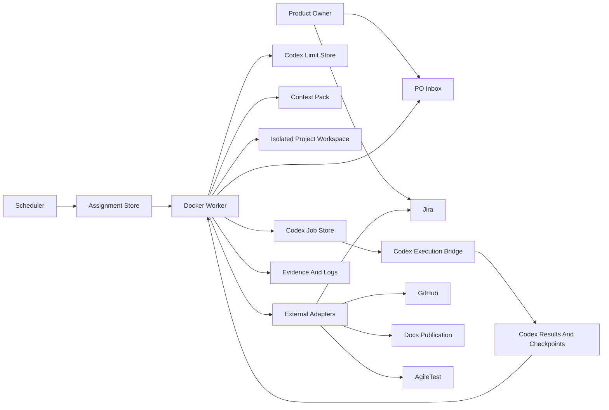

# Detached Docker Execution Architecture

Status: Release 1.2 architecture contract for `AGENT-619`.

This document defines the boundary that lets the boilerplate move from
supervised Codex sessions and dry-run Docker workers toward detached Docker
workers that can run in the background without losing Product Owner control.

## Architecture Goal

Detached Docker execution means the containerized worker can own assignment
pickup, validation gates, durable state, handoffs, pause/resume decisions, and
external adapter calls for its approved role.

Codex-backed reasoning and code generation remain behind an explicit execution
bridge. The bridge can be host-side or in-container, but every Codex request
must pass the same durable limit, scope, credential, workspace, and PO inbox
gates before it runs.

Release 1.2 implementation stories must not bypass this contract by adding
hidden long-running scripts, shared mutable checkouts, untracked prompts, or
direct external writes that cannot be tied back to a Jira assignment.

## System Boundary

The worker is not allowed to infer scope from chat history. It receives one
assignment, one role, one project identity, one context pack, one workspace,
and one durable output set.

## Components

### Scheduler

The Scheduler selects executable work only after:

1. Jira status is `READY TO START`.
2. The issue belongs to the active approved sprint.
3. Dependency and linked-bug gates pass.
4. An assignment lock can be acquired.
5. Codex limit availability allows the role route.
6. A workspace can be allocated without sharing mutable source state.
7. Required design, security, or architecture gates pass.

The Scheduler writes an `AgentAssignment` and, when Codex work is needed, a
`CodexJob` envelope.

### Docker Worker

The worker owns local role execution. It may:

1. Register itself.
2. Poll or receive trigger events.
3. Claim one assignment through the lock store.
4. Load role instructions and context.
5. Re-check Jira, dependency, PO inbox, limit, and workspace gates.
6. Call approved adapters for the assigned role.
7. Write logs, evidence, checkpoint, output, and failure artifacts.
8. Emit the next trigger event at a durable stop point.

The worker must not:

1. Work two Jira issues in the same mutable workspace.
2. Write outside its assigned workspace and durable paths.
3. Read raw Codex account/session secrets.
4. Log tokens, authorization headers, cookies, passwords, or raw `.env` data.
5. Start a future-sprint story without a Product Owner override.

### Codex Execution Bridge

The bridge is the only component that can spend Codex quota.

`HostSideCodexExecutionBridge` is the Release 1.2 worker-facing adapter. It
creates durable queued Codex jobs for the host-side runner and records
unsupported direct-container modes as failed request artifacts with
operator-readable reasons.

Supported bridge shapes:

1. Host-side bridge: a host Codex session or runner reads queued job artifacts
   and writes results.
2. In-container bridge: a later approved bridge that can execute Codex from the
   container environment without exposing subscription secrets.
3. Dry-run bridge: a deterministic fake used by tests and setup validation.

Every bridge must enforce the pre-request gate from
`docs/codex-limit-availability.md` before each quota-spending request.

### Durable Stores

Release 1.2 workers coordinate through durable stores:

1. `data/agent-state` for workers, assignments, locks, and processed trigger
   markers.
2. `data/context-packs` for story-scoped instructions and references.
3. `data/codex-jobs` for request envelopes, paused assignments, and failed
   requests.
4. `data/codex-results` for outputs, partial outputs, checkpoints, and bridge
   results.
5. `data/codex-limits` for limit availability records and resume timestamps.
6. `data/po-inbox` for blocking Product Owner questions and answers.
7. `data/agent-logs` for evidence and human-readable execution trails.

Database-backed stores can replace file stores later only if they preserve the
same assignment ids, Jira keys, role, paths, and replay semantics.

The executable checkpoint schema for this contract is documented in
`docs/detached-worker-checkpoints.md`. Release 1.2 uses file-backed checkpoints
under `data/agent-state/detached-worker-checkpoints` and an Alembic table
mirror named `detached_worker_checkpoints`.

## Assignment Lifecycle

Detached workers use this lifecycle:

1. `queued` - Scheduler created an assignment, but no worker owns it.
2. `assigned` - Worker lock is acquired and worker id is recorded.
3. `in_progress` - Worker has passed gates and started role work.
4. `waiting_codex` - Worker created or resumed a Codex job and waits for bridge
   output.
5. `paused_limit` - Limit gate closed before or during Codex execution.
6. `blocked_po` - A PO inbox question or approval blocks work.
7. `blocked_external` - Jira, GitHub, Docs, AgileTest, workspace, or credential
   validation blocks work.
8. `failed` - Work cannot continue without operator or developer intervention.
9. `completed` - The role reached its durable handoff point.
10. `cancelled` - Product Owner or Release Manager cancelled the assignment.

The current domain status enum may implement these as exact values or as a
smaller status plus a structured blocked reason. Implementation stories must
not collapse distinct reasons into a single opaque failure string.

## Checkpoint Ownership

Each component owns specific checkpoints:

| Checkpoint | Owner | Required artifact |
| --- | --- | --- |
| Scope approved | Product Owner / Jira | Jira status and sprint label |
| Assignment created | Scheduler | `AgentAssignment` |
| Worker claimed | Worker | assignment lock and worker id |
| Context loaded | Worker | context pack checksum or timestamp |
| Workspace allocated | Scheduler / Worker | workspace path and cleanup policy |
| Codex request queued | Worker | `CodexJob` |
| Codex request executed | Execution bridge | result or pause/failure artifact |
| PO question created | Worker / Adapter | PO inbox item id |
| External write performed | Adapter | Jira/GitHub/Docs/AgileTest reference |
| Handoff emitted | Worker | trigger event and evidence path |

Workers resume from the latest checkpoint they own. A worker must re-read
upstream checkpoints after restart instead of trusting stale in-memory state.
Checkpoint records must include assignment id, project id, sprint, Jira key,
role, branch, worktree path, stage, last command summary, failed request path
when applicable, and a non-secret resume recommendation.

## Gate Order

Before an assignment starts or resumes, the worker checks gates in this order:

1. Assignment lock and duplicate-worker protection.
2. Jira status, active sprint, dependency, and linked-bug state.
3. Product Owner inbox blockers for the same Jira key and project namespace.
4. Context pack key, role, project, and timestamp validity.
5. Workspace allocation and branch safety.
6. Credential/config validation for the role's required adapters.
7. Codex limit availability when the role can call the execution bridge.
8. Role-specific gates, such as UI design acceptance or security approval.

When any gate fails, the worker writes a blocked artifact and stops at the
closest durable state. It should not continue to later gates whose checks would
spend quota or mutate external state.

## Failure Handling

Failures are classified by recovery owner:

1. `product_owner_required` - missing decision, approval, requirement, or
   accepted design. Create a PO inbox item and pause.
2. `limit_unavailable` - Codex limit gate closed. Write pause artifacts and
   resume timestamp when known.
3. `developer_required` - branch conflict, failed validation, missing code
   evidence, or failed checks. Route to Developer.
4. `review_required` - PR ready for Review or process review.
5. `tester_required` - merge completed and story needs testing.
6. `release_manager_required` - sprint regression, release notes, versioning,
   closure, or publication is ready.
7. `operator_required` - missing credentials, unreachable service, bad mount,
   corrupt store, or stale lock.
8. `security_required` - credential exposure, suspicious file access, or
   unsafe external write boundary.

Every failure artifact includes Jira key, assignment id, role, worker id,
non-secret reason, next owner, and recommended next action.

## Resume Semantics

Resume must be idempotent.

On resume, the worker:

1. Reads the latest assignment and lock.
2. Re-checks Jira status, dependencies, linked bugs, and sprint membership.
3. Reads open PO inbox items for the assignment namespace.
4. Reads the latest Codex limit record.
5. Reads failed request, paused assignment, and latest checkpoint artifacts.
6. Rebuilds or validates the context pack when it is stale.
7. Reuses the same branch and workspace when safe; otherwise requests operator
   cleanup or allocates a new workspace with a recorded reason.
8. Replays only idempotent trigger events or creates a new event with a new id.

Workers must never resume an assignment under a different Jira key, project,
role, branch, or context pack unless the Scheduler writes a new assignment.

## Credential And Volume Contract

Credential rules:

1. Tokens are read from environment, Docker secrets, or an approved secret
   provider only.
2. `.env` is allowed for local dogfooding but must be redacted in logs.
3. Codex subscription/session secrets are not mounted into Docker workers.
4. Git SSH private keys or PATs are mounted only when the story and role require
   Git operations.
5. A worker logs credential field names and validation results, never values.

The security review in `docs/detached-worker-security-review.md` is the
release gate for these rules. Downstream worker implementation stories must
preserve that review's threat model, log redaction expectations, and
least-privilege credential constraints.

Volume rules:

1. `/workspace/data` is the shared durable coordination mount.
2. `/workspace/project` is the assignment workspace mount and must be isolated
   for mutable implementation work.
3. `/workspace/instructions` is read-only when workers receive a copied
   instruction bundle.
4. Dependency caches are role/project scoped and disposable.
5. Host home directories, browser profiles, raw SSH directories, and Codex app
   session folders are forbidden mounts.

## External Adapter Contract

All external writes go through adapters that receive assignment context.

Required adapter metadata:

1. Assignment id.
2. Jira issue key.
3. Project key.
4. Role.
5. Worker id.
6. Evidence path.
7. Idempotency key for create/update operations.

Adapter results must record created or updated object references such as Jira
comments, PR URLs, commit SHAs, docs publication URLs, AgileTest Test keys, and
Test Execution keys.

## Termination Behavior

Containers can stop at any time. Before normal shutdown, a worker should:

1. Stop accepting new assignments.
2. Finish or pause the active atomic step.
3. Flush logs and evidence.
4. Save assignment state.
5. Release or refresh the lock according to the stop reason.
6. Emit a `limit_paused`, `po_question_created`, `blocked_external`, `failed`,
   or `completed` event when appropriate.

On ungraceful shutdown, the next worker uses stale-lock policy and checkpoint
artifacts to decide whether it can resume, must wait, or must ask the Product
Owner/operator.

## Operator-Controlled Points

The Product Owner or operator remains in control of:

1. Moving stories into `READY TO START`.
2. Confirming missing requirements, architecture decisions, and UI designs.
3. Providing or rotating credentials and project paths.
4. Recording Codex limit availability until an approved observer is available.
5. Approving model/reasoning route changes when automatic route switching is
   not available.
6. Enabling live external writes for new projects.
7. Closing releases and accepting final release scope.

If the active Codex session does not match a job route and automatic switching
is unavailable, the worker must either use the approved fallback route already
recorded in the context pack or create a PO inbox checkpoint. The worker must not invent a route silently.

## Implementation Guardrails

Developer stories that implement this contract must prove:

1. Workers cannot start without a valid assignment and context pack.
2. Workers cannot spend Codex quota when the limit gate is closed.
3. Workers cannot write to shared mutable target checkouts.
4. Workers write redacted failure artifacts before stopping.
5. Trigger handling is idempotent and lock-aware.
6. External adapter calls include assignment metadata and evidence paths.
7. PO inbox blockers stop work until answered.
8. Container restart can resume or safely block from durable state.

These guardrails are the acceptance baseline for the Release 1.2 Docker worker
implementation stories that follow `AGENT-619`.
